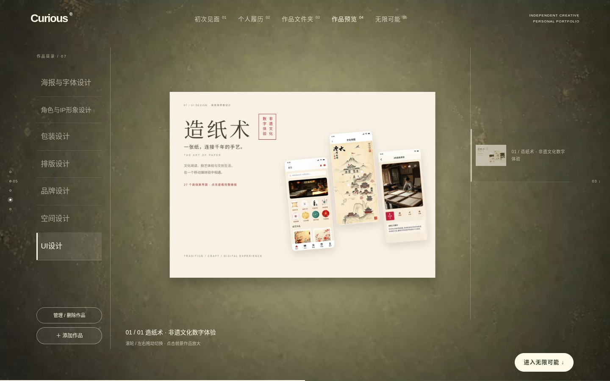

# V104 / 新增 UI 分类和造纸术展板

[返回总目录](README.md) · [上一版](v103.md) · [下一版](v105.md) · [在线最新版](https://curious-portfolio-1360346855.netlify.app/)

- 时间（北京时间）：2026-11-11 15:14
- 保存源码：`45603ecb2e0b20a7e898909388ac909ccb9fc1df`
- 源码说明：Add UI design collection and papermaking high-fidelity exhibition board
- 类型：保存源码复现的静态截图，非独立历史在线站点。

## 首页

## v104-ui.jpg

